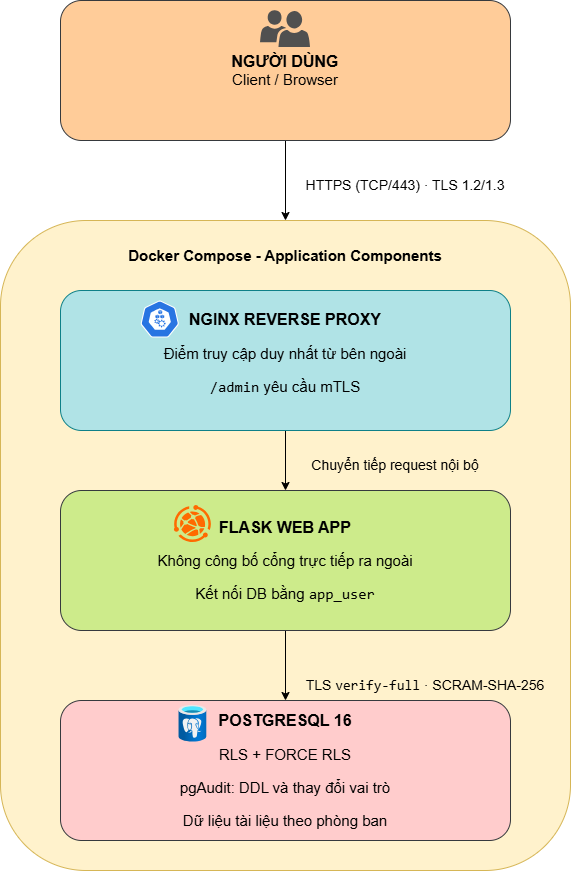

# Báo cáo kĩ thuật

Sáu mục dưới đây là khung bắt buộc. Xuất ra `bao-cao.pdf` khi nộp.

## 1. Bối cảnh và phạm vi

Nhóm đóng vai đội được một doanh nghiệp vừa và nhỏ tại Việt Nam thuê để dựng và bàn giao cấu hình an toàn cho một hệ thống nội bộ: khoảng 200 người dùng, ba máy chủ container, không có đội an toàn thông tin riêng, ngân sách công cụ dưới 30 triệu đồng một năm. Hệ thống thuộc Chủ đề A gồm nginx làm cổng vào có TLS và mTLS cho đường quản trị, một ứng dụng web nhỏ (Flask), và PostgreSQL 16 lưu dữ liệu các phòng ban.

**Tài sản cần bảo vệ.** Dữ liệu tài liệu của ba phòng ban (Kinh doanh, Nhân sự, Kế toán) trong PostgreSQL; đường quản trị `/admin`; khóa riêng và chứng chỉ TLS/mTLS.

**Trong phạm vi.** Cấu hình và vận hành an toàn của ba thành phần trên, đo bằng các loại bằng chứng mà đề yêu cầu: đầu ra testssl, chính sách Row Level Security kèm ca kiểm âm, log pgaudit, và bảng đối chiếu trước và sau khi làm cứng. Năm mối đe dọa chọn theo STRIDE (mục 2): T1 vượt quyền giữa phòng ban, T2 nghe lén tới nginx, T3 sửa gói tin giữa ứng dụng và cơ sở dữ liệu, T4 lộ khóa mTLS, T5 chối bỏ thao tác quản trị. **T4 chỉ được nhận diện, chưa có biện pháp riêng và chưa có ca kiểm** (mục 5).

**Ngoài phạm vi.** Từ chối dịch vụ không được chọn. Ứng dụng chưa có đăng nhập người dùng cuối: phòng ban của phiên lấy từ biến môi trường `APP_DEPARTMENT_ID` (đặt cố định bằng 1 trong `docker-compose.yml`), đủ để chứng minh cơ chế RLS nhưng chưa phải xác thực thật. Hệ thống chạy một máy, không có sao lưu và không có tính sẵn sàng cao. Chứng chỉ do CA tự ký của nhóm, mật khẩu trong `docker-compose.yml` và `02-roles.sql` là giá trị giữ chỗ cho dev và CI, dữ liệu là dữ liệu giả. Mọi thử nghiệm tấn công chỉ chạy trong mạng compose của chính nhóm, bằng `curl` và `psql`, không dùng công cụ khai thác.

**Tình trạng của bản nộp.**

| Hạng mục | Tình trạng |
|---|---|
| nginx: TLS 1.2/1.3, mTLS cho `/admin`, 3 ca `test-nginx.sh` | Có trong `main`, chạy trong `make verify` |
| Web: `/health`, `/db-check` có phòng ban của phiên, pytest | Có trong `main`, `test-web.sh` chạy trong `make verify` |
| PostgreSQL: RLS bật và FORCE, policy theo phòng ban (T1) | Có trong `main`, `test-db.sh` và `test-m3-security.sh` trong `make verify` |
| PostgreSQL: pgaudit ghi DDL và đổi vai trò (T5) | Có trong `main`, `test-audit.sh` trong `make verify` |
| PostgreSQL: TLS, `hostssl` + `scram-sha-256`, web `verify-full` (T3) | Có trong `main`, `test-t3-db.sh` trong `make verify` |
| Ghim digest ba image, SBOM CycloneDX, ký Cosign | Digest ghim trong ba Dockerfile; SBOM của ba image có trong `bang-chung/sbom/` và được sinh lại trong `ci.yml`; ký Cosign chỉ chạy trên `main`, các file `*.sigstore.json` không commit vào kho |
| MANIFEST sha256, quét gitleaks, `attack`, `defend`, `export-evidence`, `preflight` | Có trong `main`, nối vào `Makefile`; CI `make verify` xanh (commit `b38c8b2`) |
| Đầu ra CI của nginx, web, pytest tích hợp và gitleaks | Đã lưu trong `bang-chung/`; các tệp này là bằng chứng của commit `b38c8b2`, không xác nhận các thay đổi ở PR #33, #34, #35 vì các PR này chưa có lần chạy Actions xanh |

## 2. Mô hình đe dọa

Hệ thống Chủ đề A gồm ba thành phần nối tiếp nhau: nginx làm cổng vào, một ứng dụng web nhỏ, và PostgreSQL lưu dữ liệu các phòng ban.

Có bốn ranh giới tin cậy đáng chú ý. Thứ nhất, giữa mạng ngoài và nginx: mọi người dùng chưa xác thực chỉ chạm được cổng 443 (cổng 80 chỉ chuyển hướng). Thứ hai, giữa người dùng thường và đường `/admin`: dù cùng đi qua nginx, đường quản trị đòi xác thực chứng chỉ khách (mTLS) riêng. Thứ ba, giữa nginx và ứng dụng web, nơi ứng dụng không được publish cổng ra ngoài. Thứ tư, giữa ứng dụng và PostgreSQL, nơi Row Level Security phát huy tác dụng, vì ứng dụng kết nối bằng một vai trò riêng chứ không phải vai trò chủ sở hữu.

Ba tài sản cần bảo vệ nhất nằm sau các ranh giới trên. Quan trọng nhất là dữ liệu các phòng ban lưu trong PostgreSQL. Kế đến là đường quản trị `/admin`, vì ai chiếm được đường này gần như chiếm được quyền vận hành hệ thống. Cuối cùng là khóa riêng và chứng chỉ phục vụ TLS/mTLS: mất chúng thì hai lớp phòng thủ còn lại cũng mất theo.

Tác nhân đe dọa chia làm ba nhóm. Nhóm thứ nhất là nhân viên nội bộ có tài khoản hợp lệ nhưng cố tình hoặc vô tình vượt phạm vi được cấp. Nhóm thứ hai là tác nhân đã chiếm được một vị trí trong mạng nội bộ, từ một thiết bị bị nhiễm độc hoặc một tài khoản quản trị hạ tầng. Nhóm thứ ba là người có quyền quản trị hệ thống nhưng hành động không để lại dấu vết, cố ý hoặc vô ý.

Năm mối đe dọa được xác định, trong đó ba mối đầu khớp đúng ba mối bắt buộc của đề.

**T1** (Elevation of Privilege, T1078): một nhân viên phòng ban này, bằng tài khoản hợp lệ của chính mình, đọc được dữ liệu phòng ban khác vì tầng ứng dụng hoặc cơ sở dữ liệu không chặn theo phạm vi. Biện pháp là Row Level Security theo tham số phiên, bật thêm `FORCE ROW LEVEL SECURITY` để chính sách áp cả lên chủ sở hữu bảng.

**T2** (Information Disclosure, T1040): kẻ tấn công trên cùng phân đoạn mạng đọc trộm gói tin gửi tới nginx khi kết nối chưa mã hóa. Đây là đoạn kết nối nhóm có bằng chứng xác minh trực tiếp. Biện pháp là TLS 1.2/1.3 bắt buộc tại nginx, xác minh bằng testssl; đoạn từ ứng dụng xuống PostgreSQL được xử lý riêng ở T3.

**T3** (Tampering, T1557) nặng hơn T2 một bước: khi kẻ tấn công đã ở vị trí trung gian, cấu hình mặc định của PostgreSQL cho phép kết nối không mã hóa, nên họ không chỉ đọc mà còn chèn hoặc sửa được câu lệnh truyền đi. Biện pháp gồm hai thiết lập nằm ở hai file khác nhau nhưng phải đi cùng nhau: `ssl = on` trong `postgresql.conf` để máy chủ có khả năng phục vụ TLS, và dòng `hostssl ... scram-sha-256` trong `pg_hba.conf` kèm các dòng `host ... reject` để kết nối không TLS bị từ chối. Thiếu `hostssl` thì TLS chỉ là tùy chọn, client vẫn chọn được kết nối thường; thiếu `ssl = on` thì không kết nối nào khớp dòng `hostssl` và web mất kết nối DB. Web kết nối với `PGSSLMODE=verify-full` để kiểm chứng chỉ và tên máy chủ, tài khoản `app_user` xác thực bằng SCRAM. Nhóm không dùng chứng chỉ khách cho DB (mục 3.1 và 5.3).

**T4** (Spoofing, T1552.004): khóa riêng dùng cho mTLS bị đánh cắp, cho phép kẻ tấn công giả mạo client hợp lệ để vào `/admin`. Đường này đã đòi chứng chỉ khách (nginx đặt `ssl_verify_client optional` và trả 403 ở `/admin` nếu `$ssl_client_verify` khác `SUCCESS`), khóa được đặt `chmod 600` và không commit vào git. Riêng T4, nhóm mới dừng ở nhận diện, chưa có biện pháp riêng hay ca kiểm (mục 5).

**T5** (Repudiation, T1070): thao tác đổi vai trò hoặc thay đổi cấu trúc dữ liệu không được ghi nhận, khiến không truy vết được trách nhiệm khi có sự cố. Biện pháp là bật pgaudit ghi mọi thao tác DDL và đổi vai trò.

Nếu nginx, lớp ngoài cùng, bị vượt qua, kẻ tấn công vẫn chưa chạm được dữ liệu một cách tự do. Họ không dùng được tài khoản có quyền cao trên DB, vì web chỉ kết nối bằng `app_user`; RLS vẫn lọc dữ liệu theo phòng ban; kết nối web–DB vẫn buộc mã hóa; còn các thao tác DDL và đổi vai trò sẽ để lại dấu vết trong log pgaudit. Các lớp này dựa trên cơ chế khác nhau nên một lớp sụp đổ không kéo theo lớp còn lại. Có một giới hạn cần nói rõ: vì phòng ban hiện là cấu hình cố định của ứng dụng, RLS lọc đúng theo giá trị mà web đặt, còn việc giá trị đó lấy từ danh tính đã xác thực là phần nhóm chưa làm (mục 5).

## 3. Kiến trúc và các quyết định cấu hình, kèm lý do

### 3.1 Quyết định theo thành phần, kèm phương án đã loại

| Thành phần | Quyết định | Lý do | Phương án đã loại | Mối đe dọa |
|---|---|---|---|---|
| nginx | `ssl_protocols TLSv1.2 TLSv1.3`; cổng 80 chỉ trả `301` sang 443 | SSLv3, TLS 1.0 và 1.1 có tấn công công khai; không phục vụ nội dung trên kênh không mã hóa | Chỉ TLS 1.3: loại vì một số máy khách cũ chưa hỗ trợ | T2 |
| nginx | `ssl_verify_client optional`; `/admin` trả 403 nếu `$ssl_client_verify` khác `SUCCESS` | Người dùng thường vào `/` không cần chứng chỉ, riêng đường quản trị đòi chứng chỉ khách | `ssl_verify_client on` toàn server: loại vì người dùng thường sẽ không vào được cả phần công khai | T4 |
| nginx, web, db | Ba image ghim bằng digest sha256 | Cùng một lệnh build cho cùng một image ở mọi máy và trên CI | Ghim theo tag: loại vì tag có thể trỏ sang image khác | chuỗi cung ứng |
| web | Chạy uid 10001, không publish cổng, có `HEALTHCHECK` | Chỉ nhận request qua nginx; nếu bị chiếm thì không có quyền root | Chạy root cho dễ cấu hình: loại | T1 |
| web | Kết nối bằng `app_user`, không dùng chủ sở hữu CSDL | Vai trò chủ sở hữu bỏ qua mọi giới hạn | Dùng `postgres`: loại | T1 |
| web | `set_config('app.current_department', ..., true)` trong giao dịch; kiểm giá trị là số nguyên từ 1 đến 32767 | `true` làm giá trị chỉ sống trong giao dịch nên kết nối dùng lại không mang phòng ban cũ | `SET` mức phiên: loại vì rò sang kết nối dùng lại | T1 |
| CSDL | `app_user`: `NOSUPERUSER NOCREATEDB NOCREATEROLE NOREPLICATION NOBYPASSRLS`; thu hồi `CONNECT` và schema `public` của `PUBLIC`; chỉ `SELECT` trên `departments`, `users`, `SELECT/INSERT/UPDATE/DELETE` trên `documents`, không DDL | Đặc quyền tối thiểu; `NOBYPASSRLS` bảo đảm RLS luôn áp lên vai trò này | Cấp quyền rộng cho gọn: loại | T1, T5 |
| CSDL | `ENABLE` + `FORCE ROW LEVEL SECURITY` trên `app.documents`, policy `documents_by_department` ở `USING` và `WITH CHECK` | Lọc ngay tại dữ liệu nên đúng cả khi tầng web sót; thiếu phòng ban thì thấy 0 dòng (đóng khi thiếu) | Lọc `WHERE department_id` ở tầng web: loại vì một truy vấn sót là rò dữ liệu; một view theo phòng ban: loại vì phải tạo view cho từng phòng | T1 |
| CSDL | Tự build image từ `postgres:16` cộng `postgresql-16-pgaudit`; `shared_preload_libraries=pgaudit`, `pgaudit.log=ddl,role` (đặt trong `docker-compose.yml`) | Ghi mọi DDL và thay đổi vai trò; không bật `read`/`write` để log không phình | `log_statement=ddl` có sẵn của PostgreSQL: loại vì không ghi `ALTER ROLE` có cấu trúc và không có phân loại đối tượng | T5 |
| CSDL | `ssl = on`; `pg_hba.conf`: `hostssl appdb app_user ... scram-sha-256`, mọi `host` không TLS (IPv4 và IPv6) bị `reject`; web `PGSSLMODE=verify-full` + `PGSSLROOTCERT`; `db-entrypoint` chép khóa DB sang thư mục của PostgreSQL với quyền 600 (PostgreSQL từ chối khóa quyền rộng hơn) | Ép kết nối web–DB qua TLS, xác minh chứng chỉ máy chủ, mật khẩu băm SCRAM | **Chứng chỉ khách cho DB (`clientcert=verify-full`): loại sau review của nhóm vì buộc sửa web và thêm quản lý khóa; chuyển sang hướng mở rộng.** Bọc đường hầm riêng (WireGuard, stunnel): loại vì thêm thành phần | T3 |
| Kho mã | `Makefile` đặt `-o pipefail` | Thiếu thì `script \| tee file` trả mã 0 dù script FAIL, CI xanh giả | Không có | mọi mối |
| Kho mã | Chứng chỉ và khóa sinh bởi `scripts/generate-dev-certs.sh` khi `make up`, hạn 365 ngày; `.gitignore` chặn `*.key`, `*.crt` và các tệp trung gian trong `cau-hinh/nginx/certs/` | Khóa không nằm trong git; mỗi lần CI sinh bộ mới | Commit khóa dev: loại | T4 |

### 3.2 Cách các lớp phối hợp

nginx chặn người ngoài và đường quản trị không chứng chỉ. Nếu lớp này bị vượt, `app_user` với đặc quyền tối thiểu và RLS vẫn giới hạn dữ liệu theo phòng ban. Nếu kẻ ở vị trí trung gian nằm giữa web và DB, TLS với `verify-full` chặn đọc và sửa. Còn pgaudit để lại dấu vết cho thao tác quản trị. Mỗi lớp có cơ chế riêng nên một lớp hỏng không kéo lớp khác.

### 3.3 Chi phí và tỉ lệ (ALE, ROSI)

ALE (Annualized Loss Expectancy) bằng SLE (thiệt hại một sự cố) nhân ARO (số sự cố mỗi năm). Điểm tác động và khả năng (thang 1 đến 5) lấy từ `docs/threat-model.json`. **Các bảng quy đổi sang tiền là giả định của nhóm, không phải số đo**: tác động 1 đến 5 ứng với 2, 10, 40, 120, 300 triệu đồng mỗi sự cố; khả năng 1 đến 5 ứng với 0,05, 0,1, 0,3, 0,6, 1,0 sự cố mỗi năm; công kỹ sư 200.000 đồng một giờ, khấu hao công dựng trong 3 năm. Bảng tính bằng `python3 scripts/tinh-ale.py`; đổi giả định trong script thì bảng đổi theo. Cần người nắm số liệu thật của doanh nghiệp xác nhận trước khi dùng làm căn cứ quyết định. Công cụ đều mã nguồn mở nên chi phí là công kỹ sư, không có tiền giấy phép.

| Mối | Biện pháp | SLE trước | ARO trước | ALE trước | SLE sau | ARO sau | ALE sau | Chi phí/năm | ROSI | Bằng chứng |
|---|---|---|---|---|---|---|---|---|---|---|
| T1 | Vượt quyền giữa phòng ban (RLS) | 300,0 | 0,6 | 180,0 | 300,0 | 0,05 | 15,0 | 1,6 | 10.212% | Đã kiểm: T1-01..04, attack, defend |
| T2 | Nghe lén tới nginx (TLS 1.2/1.3) | 300,0 | 0,3 | 90,0 | 300,0 | 0,05 | 15,0 | 1,3 | 5.525% | Đã kiểm: testssl, test-nginx, attack |
| T3 | Sửa gói tin app-DB (hostssl, ssl=on) | 120,0 | 0,3 | 36,0 | 120,0 | 0,05 | 6,0 | 0,9 | 3.114% | Đã kiểm: T3-01..03, attack |
| T4 | Lộ khóa mTLS (chỉ nhận diện, chưa có biện pháp) | 300,0 | 0,1 | 30,0 | 300,0 | 0,1 | 30,0 | 0,0 | - | Không có ca kiểm; gitleaks chỉ là quét chung |
| T5 | Chối bỏ thao tác DDL/đổi vai trò (pgaudit) | 40,0 | 0,1 | 4,0 | 10,0 | 0,1 | 1,0 | 1,7 | 73% | Đã kiểm: T5-01..04, defend |
| Chung | CI, cổng an toàn, SBOM, Cosign, MANIFEST, gitleaks | - | - | - | - | - | - | 3,3 | - | - |
| **Tổng** | | | | **340,0** | | | **67,0** | **8,9** | **2.956%** | |

(Đơn vị tiền: triệu đồng. SLE: thiệt hại một sự cố. ARO: số sự cố mỗi năm. ALE = SLE x ARO.)

**Cách đọc.**

- **Tổng quan.** Chi phí khoảng 8,9 triệu đồng một năm, trong ngân sách 30 triệu; ALE tổng giảm từ 340 xuống 67 triệu. ROSI hàng nghìn phần trăm là hệ quả của công cụ miễn phí và SLE giả định lớn, nên đọc như thứ tự độ lớn, không như dự báo.
- **T4 không giảm.** Nhóm chưa làm biện pháp riêng cho T4 và không có ca kiểm, nên ALE sau bằng ALE trước và chi phí bằng 0; con số này nói thẳng rằng T4 còn nguyên 30 triệu rủi ro mỗi năm. Việc `chmod 600` và `.gitignore` chặn khóa chỉ là thói quen tốt, chưa phải biện pháp được kiểm chứng.
- **T5 giảm nhờ giảm tác động** (có log nên truy được người làm), không giảm khả năng xảy ra; ROSI chỉ 73%, thấp nhất trong năm mối.

**Khuyến nghị theo chi phí.**

| Biện pháp | Khuyến nghị | Lý do |
|---|---|---|
| RLS (T1) | Nên làm, ưu tiên cao nhất | ALE giảm nhiều nhất (165 triệu) với chi phí 1,6 triệu |
| TLS tại nginx (T2) | Nên làm | Giảm 75 triệu, gần như chỉ là cấu hình |
| TLS app–DB (T3) | Nên làm | Giảm 30 triệu, vận hành 2 giờ một năm |
| pgaudit (T5) | Làm nhưng không phải ưu tiên | Giảm 3 triệu với chi phí 1,7 triệu, lợi ích chủ yếu là truy vết khi có sự cố |
| Chứng chỉ khách cho DB (T3 mở rộng) | Chưa nên | Thêm quản lý khóa và sửa web, lợi ích bổ sung nhỏ khi `verify-full` và SCRAM đã bật |
| Biện pháp cho T4 (CRL/OCSP, vault khóa) | Nên cân nhắc nếu doanh nghiệp dùng `/admin` thật | Rủi ro lớn nhất còn lại ngoài tầm RLS |

## 4. Bằng chứng an toàn cho từng quyết định

### 4.1 Ca kiểm và bằng chứng

`make verify` chạy các script dưới đây và ghi đầu ra vào `bang-chung/`. Hai target `make attack` (góc nhìn kẻ tấn công, in `BLOCKED` hoặc `SUCCEEDED`) và `make defend` (đọc cấu hình đang chạy so với giá trị mong đợi) bổ sung hai góc nhìn trên cùng hệ thống. Trên CI (commit `b38c8b2`), `make verify` chạy xanh: nginx 3 PASS, web 8 pytest PASS, T1 6 PASS, T3 3 PASS, T5 5 PASS, pytest tích hợp M3 8 PASS, gitleaks không phát hiện bí mật, `attack` 6 BLOCKED, `defend` 9 PASS, MANIFEST 26 tệp. Các kết quả này chỉ xác nhận commit `b38c8b2`; các PR #33, #34, #35 chưa có lần chạy Actions xanh nên chưa được xác nhận bằng bằng chứng CI. Lần thử cục bộ ngày 22/10 bằng GNU Make 4.4.1 trên Windows dừng ngay ở lệnh đầu `mkdir -p` với lỗi `The syntax of the command is incorrect.`, chưa chạy ca kiểm nào; vì vậy không xem đây là kết quả kiểm thử đạt hay lỗi của ứng dụng. Git hiện bật `core.autocrlf=true`, làm các script trong worktree thành CRLF và Bash trên WSL cũng báo lỗi ký tự `\r`; cần chạy trong môi trường Linux/WSL với script ở dạng LF để có kết quả hợp lệ.

| Mã | Ca kiểm | Script | Bằng chứng |
|---|---|---|---|
| N-01..03 | `/` trả 200; `/admin` không chứng chỉ trả 403; có chứng chỉ trả 200 | `test-nginx.sh` | `bang-chung/nginx/test-nginx.txt` (đầu ra CI) |
| H-01.. | `/health`, `/db-check` và pytest web | `test-web.sh` | `bang-chung/web/test-web.txt` (đầu ra CI) |
| T1-01 | Policy tồn tại, RLS bật và FORCE | `test-db.sh`, `test-m3-security.sh` | `bang-chung/db/test-db.txt`, `t1-policy.txt`, `test-m3-security-chi.txt` |
| T1-02 | Không phòng ban trong phiên thì thấy 0 dòng | như trên | `t1-no-context.txt` |
| T1-03 | Phòng 1 chỉ thấy 2 dòng của mình; phòng ban không tồn tại thấy 0 | như trên | `t1-department-1.txt` |
| T1-04 | Ghi sang phòng khác bị từ chối (ca âm) | như trên, `attack.sh` | `t1-block-cross-department-insert.txt` |
| T2-01..03 | TLS 1.2/1.3 có, SSLv2/3 và TLS 1.0/1.1 không | testssl chạy tay | `bang-chung/testssl-localhost-8443.txt` |
| T2-04 | Cổng 80 chỉ chuyển hướng 301 sang HTTPS | `attack.sh` | `bang-chung/attack/attack.txt` |
| T3-01 | `SHOW ssl;` trả `on` | `test-t3-db.sh` | `bang-chung/db/test-t3-db.txt` |
| T3-02 | Kết nối không TLS bị `pg_hba.conf` từ chối (ca âm) | `test-t3-db.sh`, `attack.sh` | như trên |
| T3-03 | Web kết nối DB bằng TLS (`pg_stat_ssl`) | `test-t3-db.sh` | như trên |
| T5-01 | `pgaudit` nạp, cấu hình `ddl,role` | `test-audit.sh`, `test-m3-security.sh`, `defend.sh` | `test-audit.txt` |
| T5-02 | `app_user` bị từ chối DDL (ca âm) | `test-audit.sh`, `test-m3-security.sh`, `attack.sh` | `t5-app-user-ddl-denied.txt` |
| T5-03/04 | Log ghi `CREATE TABLE`, `DROP TABLE`, `ALTER ROLE` | `test-audit.sh`, `test-m3-security.sh` | `t5-pgaudit.log` (kèm sha256 trong `test-audit.txt`) |
| (T4) | Không có ca kiểm | | |

Bốn ca âm (T1-04, T3-02, T5-02, `/admin` không chứng chỉ) đều là ca kẻ tấn công thử và bị chặn. `attack.txt` ghi đủ sáu phép thử: HTTP cổng 80, `/admin` không chứng chỉ, đọc và ghi chéo phòng ban, DB không TLS, tạo bảng bằng `app_user`; dòng kết luận là "ATTACK RESULT: moi tan cong bi chan".

### 4.2 Kết quả đo được

- **T2.** testssl 3.2.2 ngày 05/10: SSLv2, SSLv3, TLS 1.0, 1.1 không được cung cấp; TLS 1.2 và 1.3 được cung cấp; điểm 93, hạng B vì chuỗi tin cậy chưa đầy đủ (CA tự ký). Lần chạy nhắm cổng 8443, trong khi `docker-compose.yml` hiện công bố cổng 443, nên kết quả này cần chạy lại trên bản cuối.
- **T1.** 6 ca của `test-db.sh` đều PASS, gồm ca âm ghi sang phòng ban khác; 4 pytest T1 trong `test-m3-security.sh` cũng PASS.
- **T3.** 3 ca của `test-t3-db.sh` đều PASS.
- **T5.** `t5-pgaudit.log` có `AUDIT: SESSION,...,DDL,CREATE TABLE`, `DROP TABLE` và `ROLE,ALTER ROLE`.
- **Góc nhìn tấn công và phòng thủ.** `attack.txt` (chạy 10/10) báo cả sáu phép thử bị chặn. `defend.txt` (chạy 09/10) có 9 dòng PASS: RLS bật và FORCE, `app_user` không bypassrls và không superuser, `ssl_protocols` chỉ TLS 1.2/1.3, `ssl = on`, đúng 1 dòng `hostssl` SCRAM và 2 dòng `host` reject, `pgaudit.log = ddl,role`, pgaudit nạp sẵn. Hai tệp chạy ở hai thời điểm khác nhau; bản chạy trên CI cùng commit là bản đối chiếu cuối.

### 4.3 Tính toàn vẹn của bằng chứng

Một file log dán tay không phải bằng chứng, nên cuối `make verify` có hai bước. `scripts/scan-secrets.sh` chạy gitleaks 8.18.4 (cùng phiên bản và sha256 với cổng an toàn) và ghi `bang-chung/secrets/gitleaks.txt`. `scripts/make-manifest.sh` ghi `bang-chung/MANIFEST.txt` (mỗi file một dòng sha256), từ chối chạy nếu có khóa riêng trong `bang-chung/`, rồi tự kiểm lại: sửa một file hoặc thêm file mới chưa vào MANIFEST thì bước `check` báo lỗi. `make export-evidence` đóng gói thư mục này vào `dist/`.

Cần đọc hai điều kiện đi kèm. Thứ nhất, gitleaks trên CI chạy trên bản clone nông (một commit), nên kết quả "không phát hiện bí mật" chỉ có giá trị cho commit đó, chưa phải toàn bộ lịch sử. Thứ hai, MANIFEST bản được commit hiện ghi sha256 của 22 tệp, nhưng 19 trong số đó được băm ở dạng xuống dòng CRLF của máy Windows chạy thử, trong khi bản lưu trong git là LF; vì vậy chỉ riêng MANIFEST này không tự kiểm lại đúng trên máy khác. Phép kiểm toàn vẹn có giá trị nằm ở bước `generate` rồi `check` chạy cuối `make verify` trên CI (26 tệp). Nhóm sẽ xử lý bằng `.gitattributes` đặt `bang-chung/** -text` và sinh lại MANIFEST sau khi chuẩn hóa về LF.

### 4.4 Bảng đối chiếu trước và sau khi làm cứng

**Lưu ý phương pháp.** Các file "trước" là **tái lập trạng thái trước khi làm cứng** (T1 tắt tạm RLS, T2 nginx gốc không TLS, T3 chạy trên `main` trước khi PR T3 được gộp, T5 PostgreSQL gốc không có pgaudit), chạy ngày 09/10. Chúng không phải ảnh chụp từ trước khi nhóm làm.

| Mối | Trước (tái lập) | Sau | Bằng chứng trước | Bằng chứng sau |
|---|---|---|---|---|
| T1 | `app_user` thấy 6 dòng của cả 3 phòng (2/2/2) | Phòng 1 thấy 2 dòng của mình; không phòng ban thì 0; ghi sang phòng khác bị từ chối | `db/t1-truoc.txt` | `test-db.txt`, `t1-*.txt` |
| T2 | Nginx gốc trả `HTTP/1.1 200 OK` qua HTTP thường | TLS 1.2/1.3, cổng 80 chuyển hướng 301 | `nginx/t2-truoc.txt` | `testssl-localhost-8443.txt`, `attack.txt` |
| T3 | Kết nối không mã hóa thành công; `SHOW ssl;` = `off` | `ssl = on`, kết nối không TLS bị từ chối, web dùng TLS | `db/t3-truoc.txt` | `db/test-t3-db.txt` |
| T4 | Không đo | Không đo | | |
| T5 | Không nạp pgaudit, 0 dòng `AUDIT:` dù đã chạy `CREATE TABLE` và `ALTER ROLE` | Log ghi DDL và `ALTER ROLE` | `db/t5-truoc.txt` | `t5-pgaudit.log` |

### 4.5 Quản trị bằng chứng

Năm file chạy tay còn chứa đường dẫn máy cá nhân dạng `/mnt/d/...` (`t1-block-cross-department-insert.txt`, `t5-app-user-ddl-denied.txt`, `t5-app-user-ddl-not-created.txt`, `test-db.txt`, `test-audit.txt`). Không lộ bí mật, nhưng nên thay bằng đầu ra do CI sinh ra khi có thể; `make-manifest.sh` hiện chỉ cảnh báo, đặt `STRICT=1` để coi là lỗi. Ngoài ra, sha256 ghi trong `test-audit.txt` của lần chạy tay khớp với `t5-pgaudit.log` đang lưu, còn bản `test-audit.txt` do CI sinh ra có sha256 khác vì log mỗi lần chạy có thời điểm và mã tiến trình riêng; không nên so sha256 giữa hai lần chạy.

## 5. Phần còn lại của rủi ro, giới hạn và hướng mở rộng

### 5.1 Rủi ro còn lại sau khi làm cứng

| Mối | Rủi ro còn lại |
|---|---|
| T1 | Phòng ban của phiên là hằng số (`APP_DEPARTMENT_ID`), chưa có đăng nhập: RLS chặn đúng khi phiên được đặt đúng, việc đặt đúng thuộc tầng xác thực chưa làm. Siêu người dùng `postgres` luôn bỏ qua RLS; ca FORCE chỉ đọc cờ `relforcerowsecurity` |
| T2 | Chứng chỉ tự ký nên hạng B; không có CRL/OCSP; còn cipher CBC (LUCKY13 mức "potentially vulnerable") và chưa có HSTS (testssl ghi "not offered") |
| T3 | DB xác thực bằng mật khẩu (SCRAM), không có chứng chỉ khách; mật khẩu giữ chỗ nằm trong `docker-compose.yml`, `02-roles.sql` và một số script kiểm thử |
| T4 | **Chưa có biện pháp.** Không có thu hồi chứng chỉ khách riêng lẻ; muốn thu hồi phải thay CA và cấp lại toàn bộ chứng chỉ; máy trạm quản trị bị chiếm thì lộ khóa |
| T5 | Chỉ bật `ddl,role`, không có `read`, nên không có dấu vết ai đã đọc dữ liệu; pgaudit ghi nguyên văn câu lệnh nên câu `CREATE ROLE ... PASSWORD` với mật khẩu thật sẽ nằm trong log (tệp bằng chứng của nhóm đã được lọc, không chứa mật khẩu) |

### 5.2 Giới hạn của công việc

- `app_user` có `SELECT` trên `app.users`, bảng có cột `password_hash` và không có RLS; chấp nhận được với dữ liệu giả, sản phẩm thật cần thu hẹp theo cột.
- Bằng chứng trước/sau là tái lập (mục 4.4); mật khẩu và chứng chỉ là giá trị dev.
- `attack.sh` và `defend.sh` có bản chạy tay (10/10 và 09/10) và bản chạy trên CI ở commit `b38c8b2`.
- SBOM và chữ ký Cosign: SBOM của ba image nằm trong `bang-chung/sbom/`; run CI 38157131284 trên commit `b38c8b2` ghi nhận `Verified OK` cho cả ba SBOM. Ký keyless chỉ chạy trên `main`, các file `*.sigstore.json` không commit vào kho nên cần tải artifact của lần chạy trên thẻ nộp. Trường tên image trong SBOM thể hiện đường dẫn tar tạm do Syft dùng khi quét, không phải tên image ổn định; cần nhận diện image bằng digest SHA-256.
- Bốn tệp đầu ra CI của nginx, web, pytest tích hợp và gitleaks đã được lưu trong `bang-chung/` từ run 38157131256. Chúng chỉ là bằng chứng cho commit `b38c8b2`; PR #33, #34, #35 chưa có lần chạy Actions xanh.

### 5.3 Điều còn bỏ ngỏ và hướng mở rộng

CA nội bộ có CRL/OCSP; đăng nhập và lấy phòng ban từ danh tính đã xác thực; chứng chỉ khách cho kết nối DB (`clientcert=verify-full`); chuyển mật khẩu sang cơ chế bí mật của orchestrator hoặc tệp `.env` nằm ngoài git; gửi log pgaudit sang nơi lưu tập trung chỉ ghi thêm; HSTS, `ssl_ciphers` chỉ AEAD, giới hạn tốc độ ở nginx; một biện pháp và ca kiểm cho T4; quét gitleaks toàn bộ lịch sử (`fetch-depth: 0`).

## 6. Kế hoạch, điều phối và phân công

Nhật ký điều phối đầy đủ ở `docs/nhat-ky-dieu-phoi.md` (mỗi dòng có ngày, người, việc, mốc); lịch sử commit và pull request là nguồn khách quan về ai làm gì.

| Thành viên | Phần việc chính | Đã làm | Chưa xong |
|---|---|---|---|
| Trần Thu Hà (trưởng nhóm) | Mô hình đe dọa, điều phối, báo cáo, ALE, bằng chứng | M1 mô hình đe dọa; M2 khung compose, `architecture.md`, duyệt PR; M3/M4 bằng chứng "trước" T1/T2/T3/T5, MANIFEST, gitleaks, `attack`/`defend`/`preflight`/`export-evidence`, chạy thật trên Docker và sửa lỗi script, báo cáo, ALE | PR bổ sung bằng chứng CI và `.gitattributes`; gắn thẻ nộp |
| Phạm Thị Tú Hảo | PostgreSQL, RLS, pgaudit | `01-schema.sql`, `02-roles.sql`, `03-rls.sql`, `04-pgaudit.sql`, `test-db.sh`, `test-audit.sh` | Quyết định quyền `SELECT` trên `app.users`; làm sạch file bằng chứng |
| Nguyễn Thị Ngọc Trâm | CI/CD, cổng an toàn, SBOM, Cosign | `ci.yml`, `Makefile`, SBOM CycloneDX, bật dòng kiểm trong `verify` | |
| Nguyễn Ngọc Quỳnh Chi | Web app, kiểm thử tích hợp | Web Flask, `/db-check`, pytest web, `test-web.sh`, `test-m3-security.sh`; review PR bằng chứng của Hà | |
| Hoàng Văn Trọng | nginx, TLS/mTLS, chứng chỉ, T3 | Cấu hình nginx, `generate-dev-certs.sh`, `test-nginx.sh`, testssl, T3 (`hostssl`, `ssl = on`, `test-t3-db.sh`) sau review | Chạy lại testssl trên cổng 443 |

Danh sách pull request và commit của từng thành viên:

| Thành viên | Pull request đã gộp | Pull request đã review của người khác |
|---|---|---|
| Trần Thu Hà | #2,#4,#5,#10,#13,#18,#29,#31 | #6,#7,#15,#16,#17,#19,#20,#22,#26,#27,#28 |
| Phạm Thị Tú Hảo | #7, #24 | #6, #23, #25, #26, #27, #30, #31 |
| Nguyễn Thị Ngọc Trâm | #16, #20, #27, #28 | #4, #5, #26, #29 |
| Nguyễn Ngọc Quỳnh Chi | #6, #15, #23, #25 | #7, #10, #13, #14, #24, #28, #30, #31 |
| Hoàng Văn Trọng | #14,#17,#19,#22,#26 | #7,#18,#25 |
